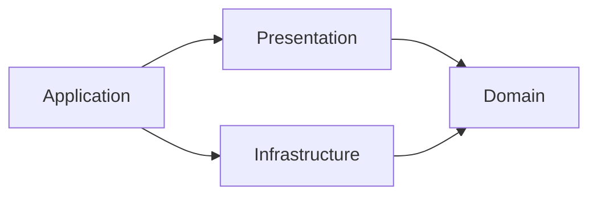

# Architecture

UnlocalFS uses Clean Architecture with MVVM. Domain and Infrastructure are the model. `UnlocalFSPresentation` holds the view models. The app target holds the SwiftUI views and Application, which builds the objects and connects them to macOS.

To add a workflow, put its rules in Domain and its integration in Infrastructure, and inject it from Application. Add a factory method for a new feature view model. Add an abstraction only at a real boundary. For tests, see [testing.md](testing.md).

## Domain

Domain imports only Foundation: no UI, Security, subprocess, or filesystem code.

- `ConnectionRepository` and `DriveGateway` are the integration contracts. View models call the gateway directly for status, test, refresh, and activity. A workflow with rules goes through a use case.
- `ConnectionField` names the field of each validation issue, so the editor maps errors to inputs without string matching.
- `TrafficMeter` turns rclone's byte counter into bytes per day. It ignores a stale reading from the same process and counts a new process from zero.

| Use case | Rule |
| --- | --- |
| SaveConnectionUseCase | A saved drive keeps its protocol, encryption, and encryption password; an SFTP drive keeps its folder. Drops unused credentials. |
| SetAutomaticConnectUseCase | Saves "connect on start up" without touching credentials. |
| DeleteConnectionUseCase | Refuses an active drive. Removes the connection, its cache, and the host keys of the last SFTP drive for a server. |
| ConnectDriveUseCase | Connects or reconnects from the current status. |
| SignInAgainUseCase | Tests and saves a new Google token, then sends it to a serving drive. Never disconnects. |
| ShareFilesUseCase | Refuses SFTP, GCS, and encrypted drives before it loads credentials. |
| DuplicateFilesUseCase | Refuses SFTP and read-only drives. Never loads credentials. |
| ExportRcloneConfigUseCase | Refuses unencrypted drives. Reads credentials only for an export with secrets. |
| QuitUseCase | Waits during an operation. Offers to disconnect, then disconnects all drives at the same time and keeps the app open on a failure. |

## Infrastructure

### Storage

- `SavedConnectionRepository` joins `ConnectionStore` (JSON) and `Keychain` under one lock. A failed save restores the old state. Delete removes the JSON first, so a failed write keeps both.
- JSON and Keychain encoding must stay readable by existing installations.
- `TrafficStore` keeps traffic per drive per day in `traffic.sqlite` (GRDB). A deleted drive keeps its rows.

### Drives

`MountService` implements `DriveGateway` and owns the rclone processes.

- Each drive runs `rclone rcd` with no credentials in its arguments or environment. `MountService` creates the remotes (`unlocalfs-<type>`, and `unlocalfs` for crypt) with `config/create`, then mounts them with `mount/mount` as `nfsmount`.
- One-off commands (connection test, share links) read the same remotes from `RCLONE_CONFIG_<NAME>_<OPTION>` variables, so no secret goes into an argument or a file.
- `rcd` does not quit when Finder ejects the drive. A status read that finds no live mount tells rclone to quit.
- Traffic counts rclone's bytes minus server-side copy and move bytes. `MountService` saves it before an eject, because rclone quits when the drive unmounts.

### Google Cloud Storage

- The token goes only into rc bodies, the connection test environment, and an export with secrets. Environment values override the rclone config, so a running drive must not get the token from its environment, or `config/update` cannot replace it.
- Without a token, rclone uses other Google credentials on the Mac. So `MountService` refuses to start rclone for a Google drive with no token or no client.
- Only one sign-in runs at a time.
- An upload error with `invalid_grant` sets `needsSignIn`.

### SFTP

- `SFTPTrustStore` owns the only trusted-hosts file. `RcloneRemote` requires its path, so no SFTP command runs without host verification.
- Approval saves only the reviewed keys, so a later key change fails again.

### Upload safety

These checks stay in Infrastructure, because uploads can change between two operations.

- `MountService` checks for pending uploads before it ejects and again before it stops rclone.
- If the status read fails but the socket answers, `MountService` reads only `vfs/queue` and disconnects normally when no upload waits.
- If the socket does not answer, rclone cannot report or save uploads. `MountService` force-ejects the drive and kills rclone.
- A saved pid counts only if its process started before `MountService` wrote the pid file. So `MountService` never signals a process that reused the pid.
- A share link or a server-side copy waits until the file finishes its upload.
- rclone cannot remove a queued upload, so a stop deletes the file through the mount. A stop deletes nothing when the upload has finished. If the upload finishes between that check and the delete, the delete also removes the new server copy.
- A copy runs with `operations/copyfile` in the drive's rclone, which already has the credentials. A drive does not disconnect while a copy runs.
- Multipart cleanup runs on the bucket, not on the crypt layer.

## Presentation

The app target has no tests. So view models decide what the UI shows: which items, their order, and counts. Views decide how it looks.

- Views change `AppViewModel` state only through intents such as `toggle`. They can set the selection and what the app presents.
- `DriveCondition` is the one value behind the status text and dot. Its switches have no `default`, so a new case fails to compile. It hides whether the drive is mounted, so button rules read the status.
- `ViewModelFactory` makes the feature view models. Views get it from the environment, so they do not know about repositories, gateways, or use cases.
- `GoogleSignInRun` returns a token only if it is still the current run. The editor locks while a sign-in runs.
- The gateway returns activity in no set order. `TransferSummary` sets the order.
- The status shows rclone's last upload error only while uploads fail, because rclone never clears it.
- The speed history keeps the newest sample of each second, because rclone updates `speedAvg` about once a second. It drops samples newer than the latest one, so a clock that moves back leaves no future points.

## Application

- `AppDependencies.live()` builds the live objects. `AppDelegate` starts the status poll and handles network, sleep and wake, termination, and Finder services.
- A status pass asks all drives at the same time, so a slow drive delays only itself. A drive operation discards pending results.
