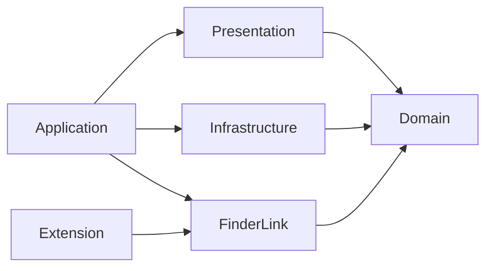

# Architecture

UnlocalFS uses Clean Architecture with MVVM. Domain and Infrastructure are the model. `UnlocalFSPresentation` holds the view models. The app target holds the SwiftUI views and Application, which builds the objects and connects them to macOS.

To add a workflow, put its rules in Domain and its integration in Infrastructure, and inject it from Application. Add a factory method for a new feature view model. Add an abstraction only at a real boundary. For tests, see [testing.md](testing.md).

## Domain

Domain imports only Foundation: no UI, Security, subprocess, or filesystem code.

- `ConnectionRepository` and `DriveGateway` are the integration contracts. View models call the repository to save the automatic connect preference and the gateway for status, test, refresh, and activity. A workflow with rules goes through a use case.
- `ConnectionField` names the field of each validation issue, so the editor maps errors to inputs without string matching.
- `TrafficMeter` turns rclone's byte counter into bytes per day. It ignores a stale reading from the same process and counts a new process from zero.

| Use case | Rule |
| --- | --- |
| SaveConnectionUseCase | A saved drive keeps its protocol, encryption, and encryption password; an SFTP drive keeps its folder. Drops unused credentials. |
| DeleteConnectionUseCase | Refuses an active drive. Removes the connection, its cache, and the host keys of the last SFTP drive for a server. |
| ConnectDriveUseCase | Connects or reconnects from the current status. |
| SignInAgainUseCase | Refuses a different Google Drive account. Tests and saves a new Google token, then sends it to a serving drive. Never disconnects. |
| ShareFilesUseCase | Refuses SFTP, GCS, Google Drive, and encrypted drives before it loads credentials. |
| DuplicateFilesUseCase | Refuses SFTP and read-only drives. Never loads credentials. |
| FileVersionsUseCase | Refuses drives that are not S3 before any rc call. Lists nothing when versioning is off. A restore also refuses read-only drives. |
| ExportRcloneConfigUseCase | Refuses unencrypted drives. Reads credentials only for an export with secrets. |
| QuitUseCase | Waits during an operation. Otherwise offers to disconnect when a drive is active. |

## Infrastructure

### Storage

- `SavedConnectionRepository` joins `ConnectionStore` (JSON) and `Keychain` under one lock. A failed save restores the old state. Delete removes the JSON first, so a failed write keeps both.
- JSON and Keychain encoding must stay readable by existing installations.
- `TrafficStore` keeps traffic per drive per day in `traffic.sqlite` (GRDB). A deleted drive keeps its rows.

### Drives

`MountService` implements `DriveGateway` and owns the rclone processes.

- Each drive runs `rclone rcd` with no credentials in its arguments or environment. `MountService` creates the remotes (`unlocalfs-<type>`, and `unlocalfs` for crypt) with `config/create`, then mounts them with `mount/mount` as `nfsmount`.
- One-off commands (connection test, share links) read the same remotes from `RCLONE_CONFIG_<NAME>_<OPTION>` variables, so no secret goes into an argument or a file.
- `rcd` does not quit when Finder ejects the drive. A status read that finds no live mount tells rclone to quit.
- Traffic counts rclone's bytes minus server-side copy and move bytes. `MountService` saves it before an eject, because rclone quits when the drive unmounts.

### Google Cloud Storage

- The token goes only into rc bodies, the connection test environment, and an export with secrets. Environment values override the rclone config, so a running drive must not get the token from its environment, or `config/update` cannot replace it.
- Without a token, rclone uses other Google credentials on the Mac. So `MountService` refuses to start rclone for a Google drive with no token or no client.
- Only one sign-in runs at a time.
- An upload error with `invalid_grant` sets `needsSignIn`.

### Google Drive

- Google Drive uses the same sign-in, token transport, and recovery as GCS, with the `drive.file` scope on the same client. `usesGoogleSignIn` covers both.
- `drive.file` reaches only files made through the UnlocalFS client, so every export holds the client ID and secret. The token goes in only with secrets.
- After a Drive sign-in, `MountService` reads the account's `permissionId` from Drive `about`. `SignInAgainUseCase` refuses a sign-in whose ID differs from the saved one, so waiting uploads never go to another account.
- The connection test accepts `directory not found`: the VFS lists a missing folder as empty and makes it on the first write.

### SFTP

- `SFTPTrustStore` owns the only trusted-hosts file. `RcloneRemote` requires its path, so no SFTP command runs without host verification.
- Approval saves only the reviewed keys, so a later key change fails again.

### Upload safety

These checks stay in Infrastructure, because uploads can change between two operations.

- `MountService` checks for pending uploads before it ejects and again before it stops rclone.
- If the status read fails but the socket answers, `MountService` reads only `vfs/queue` and disconnects normally when no upload waits.
- If the socket does not answer, rclone cannot report or save uploads. `MountService` force-ejects the drive and kills rclone.
- A saved pid counts only if its process started before `MountService` wrote the pid file. So `MountService` never signals a process that reused the pid.
- A share link or a server-side copy waits until the file finishes its upload.
- rclone cannot remove a queued upload, so a stop deletes the file through the mount. A stop deletes nothing when the upload has finished. If the upload finishes between that check and the delete, the delete also removes the new server copy.
- A copy runs with `operations/copyfile` in the drive's rclone, which already has the credentials. A drive does not disconnect while a copy runs.
- Multipart cleanup runs on the bucket, not on the crypt layer.
- Versions go through the drive's own remotes with a `versions=true` override (`unlocalfs-s3,versions=true:…`, and for crypt `unlocalfs,remote='…':`), so no credentials leave the running rclone. One non-recursive listing of a folder gives both a file's history and the folder's deleted files; `VersionListing` in Domain reads rclone's `-vYYYY-MM-DD-HHMMSS-mmm` names. A restore is a server-side `operations/copyfile` with the versioned remote on both sides, in the same job group as a duplicate, so a drive does not disconnect while it runs.
- The versioning state is read only when a versions window loads. The Finder menu offers the items on every S3 drive and keeps no versioning state.

### Finder extension

`UnlocalFSFinder` is a sandboxed Finder Sync extension. It links only Domain and `UnlocalFSFinderLink`, and holds no rules: the app is the only source of truth.

- The app answers on one `CFMessagePort` (`FinderSyncPort`), named after the team-prefixed app group that the extension claims, so the sandbox allows the lookup. An `NSXPCListener` with a Mach name would need a launchd job.
- `UnlocalFSFinderLink` holds both ends of the port and of the change notification: `FinderSyncPort` in the app and `FinderSyncClient` in the extension. Only this target knows the message format, the port name, and the notification name. The requests, replies, and snapshot are Domain values. A message from another protocol version fails like an unreadable one, on both sides, so an old extension clears its badges instead of retrying.
- The `APP_GROUP` and `FINDER_PORT_NAME` build settings in `project.yml` set the extension's app group and the port name in both Info.plists.
- After a status pass changes the snapshot, the app posts a Darwin notification. Each extension process (Finder, and one for each open or save panel) then pulls the snapshot. It also pulls every 30 seconds and when Finder shows a file for the first time.
- Each reply says, for each drive, when the last status pass that read it started. A pass skips busy drives, so they keep their old time. `FinderBadgeCache` badges a file that Finder shows for the first time only after a later pass read its drive, so a new file never shows uploaded early, and a busy drive holds back only its own files. A timed-out pull keeps the badges and tries again; a missing port or a reply the extension cannot read clears them.
- A right-click on the empty area of a folder window sends the folder as the selection, so one folder and a folder window get the same items.
- `FinderBadges` maps a Finder URL to a drive by whole path components and rolls each queued upload up to its folders and the drive root, so the extension needs no file access.
- The port does not check the sender. Any process of the same user can already reach the drives through the rc sockets. Every command goes through `ShareFilesUseCase`, `DuplicateFilesUseCase`, or `FileVersionsUseCase`, which check each file.

## Presentation

The app target has no tests. So view models decide what the UI shows: which items, their order, and counts. Views decide how it looks.

- Views change `AppViewModel` state only through intents such as `toggle`. They can set the selection and what the app presents.
- Disconnect All and the quit prompt use one `AppViewModel` path that disconnects all drives at the same time. A drive that stays connected shows its error or its pending uploads. Only the first failure in list order gets an alert. Quit disconnects the drives that the quit check found active, not the cached statuses, because a status pass can still be running.
- `DriveCondition` is the one value behind the status text and dot. Its switches have no `default`, so a new case fails to compile. It hides whether the drive is mounted, so button rules read the status.
- `ViewModelFactory` makes the feature view models. Views get it from the environment, so they do not know about repositories, gateways, or use cases.
- A versions window opens from a `VersionsTarget`: `AppViewModel` resolves the Finder URL, and `VersionsWindows` in Application makes the view model and hosts it in an AppKit window, because `openWindow` needs a view and the factory needs the app view model first. Closing the window stops a list or a download, not a restore. A show command gets the `windowOpened` reply after the window exists, and only then does the extension bring the app forward, because macOS lets the app take focus only from the user's click.
- `GoogleSignInRun` returns a token only if it is still the current run. The editor locks while a sign-in runs.
- The gateway returns activity in no set order. `TransferSummary` sets the order.
- `finderSnapshot` is derived from `statuses`, and its version is its hash. `finderMenu` and the use cases read the same `Connection.shareLinkRefusal` and `serverCopyRefusal`, so the menu never offers an action that the use case refuses.
- The Settings view reads the Finder extension switch itself, because no rule depends on it.
- The status shows rclone's last upload error only while uploads fail, because rclone never clears it.
- The speed history keeps the newest sample of each second, because rclone updates `speedAvg` about once a second. It drops samples newer than the latest one, so a clock that moves back leaves no future points.

## Application

- `AppDependencies.live()` builds the live objects. `AppDelegate` starts the status poll and handles network, sleep and wake, termination, and the Finder extension port.
- A status pass asks all drives at the same time, so a slow drive delays only itself. A drive operation discards pending results.
