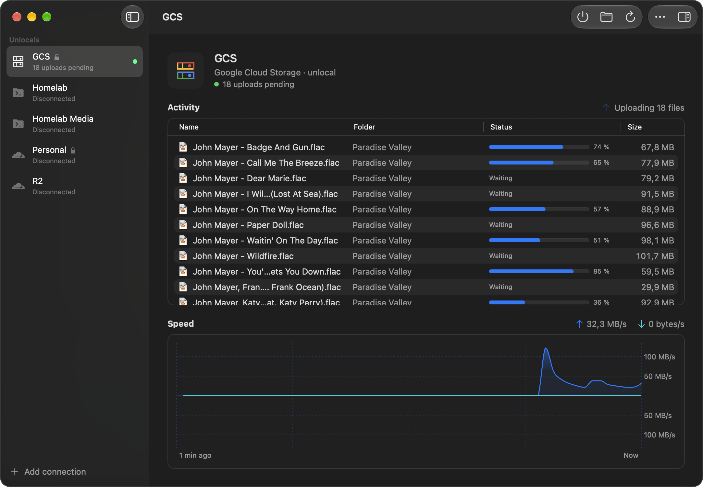

import WorksWith from '../../components/WorksWith.astro';

UnlocalFS puts your S3 or Google Cloud Storage bucket, a Google Drive folder, or your SFTP server in Finder. Browse, open, and save files, or connect one folder as its own drive.

[Download UnlocalFS](https://github.com/luizkowalski/unlocalfs/releases) · [Connect your first drive](/getting-started/)

## Works with

<WorksWith />

Plus any other S3-compatible storage.

## What you can do

- Open and edit files from Finder and your Mac apps.
- Encrypt file contents and names before upload.
- Connect separate folders as separate drives.
- Use read-only drives and connect automatically when the app opens.
- See file transfers and wait for uploads before disconnecting.
- Copy download links that expire.

## How it works

UnlocalFS bundles [rclone](https://rclone.org) and uses the NFS client built into macOS. No kernel extension, FUSE driver, or administrator password is required.

Drives appear in `~/UnlocalFS`. Opened files are cached locally. Changes upload after you close the file. S3 is remote storage: uploading a large file still takes time.

There is no UnlocalFS account, analytics, or telemetry. Read about [privacy](/privacy/) and [drive settings](/drive-settings/).
